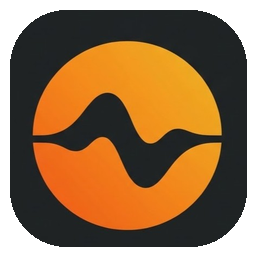

<p align="center">
  
</p>

# SolarStudio DAW (v2.1.0)

**SolarStudio** is a native cross-platform AI Digital Audio Workstation (macOS 13+ Universal & Windows 10+ x64) built with **C++20** and **JUCE 8.0.4**, combining a multi-track DAW timeline (*The Canvas*) with AI vocal synthesis, acoustic instrument performance modeling, generative music & stem splitting, natural-language AI agent control, video scoring, third-party VST3/AU plugin hosting, and the companion **SolarStudio Bridge** VST3/AU plugin.

## Core Features

1. **AI Vocal Synthesis & Voice Processing**
   - **MIDI-to-Vocal Synthesis Engine**: Vowel/phoneme-aware formant vocal synthesizer with real-time vibrato, breathiness, tension, and falsetto control.
   - **144 AI Singer Library across 8 Languages & 8 Genres**: English, Chinese, Japanese, Korean, Spanish, Italian, French, and Portuguese across Pop, Rap, Country, Ballad, Chanson, Afro, Theatre, and Kids Choir.
   - **Custom Voice Cloning & Voice Conversion**: Train and register custom AI singing voices from vocal WAV/FLAC/MP3 samples.
   - **Vocal-to-MIDI & Lyric Recognition**: Extracts MIDI notes and syllables from vocal audio with double-click inline lyric correction.
   - **Expressive Parameter & Curve Editing**: Dynamics Pen drawing, Pitch Lock Brush (protects traced pitch regions from AI regeneration), and color-coded Visual Edit Tracking.
   - **Speech Generator & Vocal Doubles**: Built-in spoken voiceover mode and stereo vocal doubling.

2. **AI Instruments & Performance Modeling**
   - Symphonic, Chamber, and Cinematic String Sections (Violins I & II, Violas, Cellos, Contrabass), Solo Violin, Alto & Tenor Saxophone, Trumpet (Open / Harmon Mute), and Armenian Duduk with articulation control.

3. **Generative Music, Stem Splitting & Sound Design**
   - **Inspire Me**: Full-song generation in *From Idea* and *Lyrics & Style* modes with History, prompt copy, and drop-to-Canvas auto-BPM detection.
   - **Generative Kits**: Layer Generator, Music Enhancer, and Inspire Starter.
   - **4-Mode AI Stem Splitter**: *Basic* (with optional Vocal Reverb Removal), *Professional* (6 stems), *Advanced* (all detected stems), and *Custom* (text-prompted extraction).
   - **AI Sound Effects Generator**: Text-to-SFX with looping toggle and prompt influence control.

4. **AI Agent & Natural Language Control**
   - Integrated AI Agent panel supporting Built-In Solar Agent plus external LLMs (ChatGPT, Claude, Gemini, Ollama/MCP).
   - Automated Key & Chord Estimation (populates Chord Track), Harmony Track generation, and third-party VST3/AU plugin search & insertion.

5. **Video & Multimedia Production**
   - Timeline Video Track with automatic scene cues and 1-click **AI Video Composer Agent**.
   - **AI Music Video Generator** supporting *Highly Customized* (16:9 full-length) and *Promo Clip* (9:16 social cut) modes.

6. **Core DAW Architecture, Bridge & Installers**
   - **The Canvas**: Opens clean and empty by default, supports Spacebar Play/Pause, drag-and-drop audio/video, Turbo Mode, Master Bus Limiter, and WAV/MIDI export.
   - **SolarStudio Bridge**: Companion VST3/AU plugin syncing host DAW transport and streaming directly into Ableton, Logic, FL Studio, Cubase, or Reaper.
   - **Automated Builds & Installers**: Windows x64 Inno Setup `.exe` (with `SolarStudio.ico` as installer & app icon) and macOS Universal `.pkg` / `.dmg` (with `SolarStudio.icns`) built automatically via GitHub Actions.

## Building Locally

```bash
cmake -B build -DCMAKE_BUILD_TYPE=Release
cmake --build build --config Release --parallel
```

## Optional Local AI Bridge Server

```bash
python3 Backend/solar_ai_server.py
```
